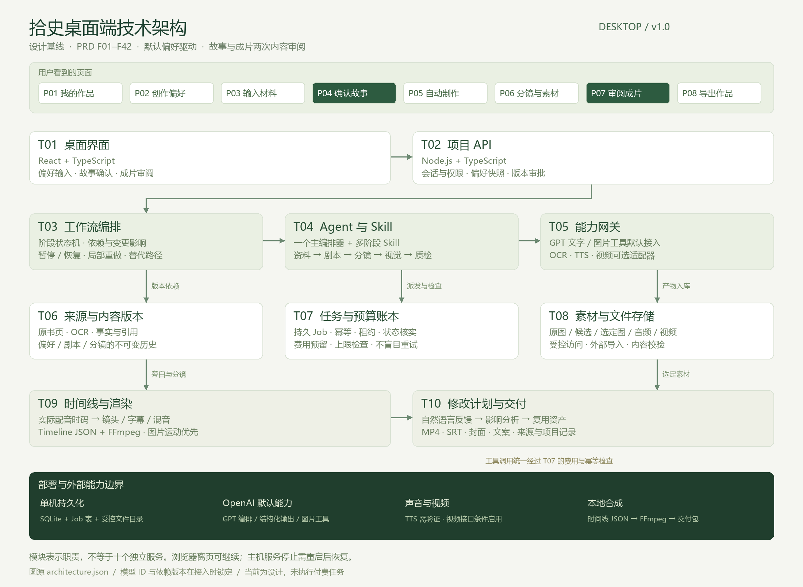

# 拾史桌面端技术规格说明书

版本 v1.0　日期 2026年10月24日　产品基线 shishi-desktop-v1.0

## 1 开发目标与规格效力

本文将 PRD F01–F42 转化为可实施的接口、数据、任务、模型与渲染规格。范围是单用户桌面 Web：首次设置偏好，导入书页，确认故事，由后台完成分镜、图片、配音及基础剪辑，最后审阅并导出。正式代码尚未实现；接口、DDL 和 JSON Schema 是开发契约，不表示生产服务已可调用。

需求行为以 PRD 为准。本文、技术架构图、需求追踪和原型共同组成 v1.0 设计基线。正文约束与机器契约冲突时不得自行选择其中一个继续开发，先修正同版本基线草稿；基线冻结后通过新版本更正，不覆盖历史标签。所有新增业务行为先关联需求，不以技术实现方便为由增加用户审批。

P0 成片路径使用图片、运动、旁白、字幕与混音，完整支持导出；真实图生视频为默认关闭的可选适配器。模型与声音服务选定并通过接入测试后锁定配置，不在规格中承诺尚未核验的模型 ID、权限、价格和耗时。

## 2 技术选型与应用组织

采用 TypeScript 单仓库、React 前端、Node.js API 与独立 Worker、SQLite 数据库、受控本地文件存储及 FFmpeg。首版保持一个调度实例，避免分布式基础设施维护成本。HTTP 框架、构建工具、数据库访问库和测试框架在启动实现时选择兼容版本写入依赖锁文件；这些工程选择不得改变契约。

| 目录建议 | 职责 | 开发边界 |
| --- | --- | --- |
| apps/web | P01–P08、表单、播放器和状态展示 | 不保存长期模型密钥，不直接提交付费任务 |
| apps/api | 会话、项目、上传、审批与资源查询 | 请求校验和权限检查，异步任务只返回受理结果 |
| apps/worker | Job 调度、模型执行和渲染 | 租约、费用检查、状态核实与失败恢复 |
| packages/contracts | OpenAPI、Schema 与共享类型 | 由契约生成类型，避免前后端各写一套 |
| packages/domain | 项目版本、依赖图、审批和修改计划 | 纯业务规则可脱离供应商测试 |
| packages/providers | GPT、图片、识读、声音和可选视频 | 同一能力接口，供应商差异不进入页面 |
| packages/render | Timeline 校验与 FFmpeg 执行 | 确定性渲染，不调用 Agent 决定文件路径 |
| skills | 阶段方法、模板、检查与版本清单 | Skill 不能绕过工具权限和预算门槛 |
| runtime | 数据库、用户文件、缓存与本地日志 | 不纳入 Git，不打包进设计交付 |

部署初期可在本机运行，浏览器关闭后 API 和 Worker 仍需运行才能继续任务；主机休眠或服务退出不会在其他地方继续执行。远程私有部署复用 API 与 Worker，但需登录、HTTPS 和私有文件访问。两种模式均不把单用户等同于无访问控制。

## 3 技术架构与模块

T01 界面通过 T02 API 访问业务；T03 编排阶段和依赖，T04 按阶段加载 Skill，T05 统一访问供应商。T06 保存来源和内容版本，T07 维护任务与预算，T08 管理文件与素材，T09 根据实际音频构造时间线并渲染，T10 解析修改并交付。所有付费工具调用必须经过 T07，不能让 Agent 直接持有供应商密钥并随意发起任务。

主链为资料整理、故事生成、版本确认、分镜与配音、图片、可选视频、时间线、预览和导出。分镜先生成语义草稿，配音后校准时长，不能假定每镜固定五秒。UI 的八个页面是用户任务入口，不是八道逐项人审关卡。

## 4 全局数据约定

ID 由服务端创建 UUID 字符串；数据库内部事件序号可以用自增整数。时间统一保存为 UTC ISO 8601，展示按用户设置时区。时长使用整数毫秒，时间线使用整数帧，画幅和坐标单位明确。所有内容版本保存父版本和输入摘要，内容版本号与产品版本号分离。

费用使用币种加整数最小记账单位。CNY、USD 统一采用百万分之一货币单位记账，字段名 amount_micros；展示元或美元时再换算，不能用浮点数累积。跨币种报价需保存汇率来源、取值时间和保守换算值；没有可靠成本边界时停止付费派发。

API 使用 camelCase，数据库使用 snake_case，由持久层映射。未知与空值区分：预算 null 表示未设置，0 表示禁止新增付费；页码 null 表示无法识别，不等于零页。大文件和媒体二进制不存进 JSON 或 SQLite，实体只保存对象引用、哈希和元数据。

## 5 数据模型与数据库约束

配套 contracts/schema.sql 定义可在 SQLite 中创建的设计 DDL。启用外键，数据库文件位于主机本地磁盘；连接设置 busy_timeout。WAL 模式、备份方式和驱动配置在接入测试验证，数据库不放网络共享盘。

| 表 | 关键字段 | 必须保持的约束 |
| --- | --- | --- |
| preference_versions | id、payload_json、created_at | 保存后不可变，创建新记录更新默认指针 |
| projects | id、row_version、preference_id、overrides_json、status | 乐观锁；软删除；不默认继承上一条材料 |
| source_pages | project_id、asset_id、page_order、printed_page、ocr_json | 真实页码可空，图片序号不可冒充原书页码 |
| source_spans | page_id、text、bbox_json、revision | bbox 使用归一化坐标；修订建立新片段 |
| claims | project_id、kind、status、statement | 事实、观点和演绎分离 |
| claim_sources | claim_id、span_id | 引用必须存在；跨项目引用由服务层禁止 |
| script_versions | project_id、parent_id、content_json、status | 批准内容不可原地覆盖 |
| approvals | project_id、target_type、target_id、version_hash | 同一内容重复批准不重复启动任务 |
| workflow_runs | project_id、script_id、snapshot_json、status | 固定产品、偏好、Skill、schema 与模型配置 |
| jobs | run_id、idempotency_key、provider_task_id、lease_until | 唯一幂等键；未知状态不等于失败 |
| budget_entries | project_id、job_id、kind、amount_micros、currency | 预留、结算和释放为追加记账，不静默改账 |
| assets | project_id、kind、storage_key、sha256、status | 路径由服务生成，原文件与生成文件分开标记 |
| shots | run_id、shot_key、payload_json | 同一 run 下 shot_key 唯一 |
| dependency_edges | project_id、from_ref、to_ref、relation | 引用类型和范围校验；不得形成非法循环 |
| timeline_versions | project_id、parent_id、payload_json、status | 旧预览在新渲染完成前继续可辨识访问 |
| feedback | project_id、target_id、text、plan_json | 保存原意见与结构化修改计划 |
| exports | project_id、timeline_id、status、manifest_json | 仅成功且获批准版本进入正式导出 |
| project_events | seq、project_id、event_type、payload_json | 用于增量通知；数据库实体仍是恢复依据 |

表的存在性外键无法替代所有项目范围检查。例如 script_id 和 project_id 都合法但属于不同项目，服务层仍必须拒绝。parent_id 不允许引用自己，版本链无循环，删除只标记状态并由保留策略清理。DDL 的 SQL 执行测试是设计校验，不是正式迁移验收。

## 6 HTTP API 契约

配套 contracts/openapi.json 使用 OpenAPI 3.1 组织资源。所有业务接口位于 /api/v1，要求会话；Cookie 会话的写操作校验 CSRF。以下是首版接口组，具体字段以 OpenAPI 的 schema 为准。

| 方法与资源 | 行为 | 关联需求 |
| --- | --- | --- |
| GET POST /projects | 分页列表、幂等创建草稿 | F01–F03 |
| GET PATCH DELETE /projects/{projectId} | 读取、版本校验更新、软删除 | F01、F04、F06 |
| GET POST /preferences | 默认偏好查询和新建不可变版本 | F05–F09 |
| POST /projects/{projectId}/sources | 上传文件或粘贴正文，返回处理资源 | F10–F15 |
| GET /projects/{projectId}/sources | 页序、识读状态与来源列表 | F12、F15 |
| POST /projects/{projectId}/story-runs | 受理故事生成，不阻塞请求 | F14、F16、F17 |
| GET /projects/{projectId}/scripts | 查询剧本历史与活动版本 | F16、F19 |
| POST /projects/{projectId}/scripts | 人工编辑生成新剧本版本 | F19 |
| POST /projects/{projectId}/approvals | 批准确切版本，幂等创建后续批次 | F18、F36 |
| GET /projects/{projectId}/runs | 查询工作流与阶段真实状态 | F21、F25 |
| POST /projects/{projectId}/run-actions | 暂停、恢复或受控重试 | F22–F24、F26 |
| GET /projects/{projectId}/shots | 分镜、旁白、候选与选中素材 | F27–F31 |
| POST /projects/{projectId}/shot-actions | 替换、选中或请求新增候选 | F27–F31 |
| POST GET /projects/{projectId}/feedback | 受理反馈、查询修改计划，必要时询问一次 | F32–F36 |
| GET /projects/{projectId}/events | cursor 后的事件增量查询 | F01、F21、F37 |
| POST GET /projects/{projectId}/exports | 创建导出或查询包状态 | F38–F41 |
| GET /assets/{assetId}/content | 鉴权读取，支持播放器 Range | F37、F38 |

列表使用 limit 和 cursor，limit 默认 20、最大 100；无结果返回空数组。创建或产生副作用的 POST 需要 Idempotency-Key；编辑与审批请求包含 expectedVersion 或明确的内容 versionHash。PATCH 项目版本冲突返回 409，UI 显示对方已更新，用户决定刷新或合并，不悄悄覆盖。

异步创建返回 202 和真实 jobId/runId；纯记录创建返回 201；删除返回 204；校验失败返回 422；不存在或越权对象统一返回 404，未登录返回 401。错误体包含 code、message、requestId、details，预算阻塞为正常工作流状态，不用模糊的 500 表示。供应商错误转换为 PROVIDER_*，保留可追踪请求 ID，不把密钥或完整原文回显。

幂等作用域为用户、HTTP 方法、规范化路径和键。相同键及相同请求摘要返回第一次结果；相同键不同摘要返回 409 IDEMPOTENCY_CONFLICT。数据库持久保存审批和任务级幂等，HTTP 幂等记录建议保留至少 30 天；清理后仍不能重新启动同一已批准版本的制作批次。

## 7 工作流与任务状态机

WorkflowRun 状态为 draft、running、waiting_review、blocked、paused、completed、failed、cancelled；blocked 包含 reasonCode。故事确认与成片确认分别用审批对象和当前阶段区分，不增加用户逐镜确认。

| Job 状态 | 含义 | 允许的后继 |
| --- | --- | --- |
| queued | 已持久化但未认领 | leased、cancelled |
| leased | Worker 持租约，尚未提交外部任务 | submitting、queued、failed、cancelled |
| submitting | 已进入外部提交边界 | submitted、running、unknown、failed |
| submitted | 已知服务商任务 ID | running、succeeded、failed、cancel_requested、unknown |
| running | 服务商执行或本地处理 | succeeded、failed、cancel_requested、unknown |
| unknown | 提交或结果无法确定 | submitted、running、succeeded、failed、cancel_requested |
| cancel_requested | 请求取消，不保证服务商停止计费 | cancelled、succeeded、failed、unknown |
| succeeded failed cancelled | 本次尝试终态 | 不修改终态；重试创建新 attempt 或新 Job |

schema 中 Job 状态枚举与本表一致。WorkflowRun.completed 必须满足时间线渲染成功且产物通过校验；“已导出”属于 Export 状态，不等同于供应商媒体生成成功。内容状态 draft、review_pending、approved、stale 与任务状态分开。

初版租约建议 60 秒、心跳每 15 秒；这些是工程初值，应在崩溃测试与主机负载测试后调整。抢占使用短事务，并以旧 owner、attempt 和 row_version 防止过期 Worker 覆盖新状态。暂停只禁止新派发，已提交任务继续核实并保留费用预留。

## 8 并发幂等与费用预留

任务认领、预算检查与预留在短数据库事务中完成，网络请求不放在事务内。初始图片并发不超过 2、视频不超过 1；每镜一个候选，自动增加候选受预算和质检结果约束。渲染独立限流，避免多个 FFmpeg 占满内存。

可用额度等于批准上限减已结算支出减仍有效的预留。预算 null 或 0 阻止所有新增付费 API，包括文字和图片；用户仍可编辑、导入外部结果、查看已有产物与本地渲染。预算设置必须成为实际授权记录，原型中的输入值不能直接迁移成付费授权。

提交前持久化稳定 requestKey、输入哈希和预算预留。服务商支持幂等时传入同一键；不支持时承认无法实现跨网络的绝对只提交一次。提交后进程崩溃、响应丢失或请求超时时进入 unknown，查询原任务，不自动再次生成。

未知费用继续占用预留。结算采用追加条目，结算支出与释放原预留在同一事务中记录；不能重复扣减。报价可能变化或估计不能约束实际扣费时暂停提交，不以“估算上限”声称绝对不超支。已发生费用的失败任务默认不自动重试；原订单重查不计为新的生成尝试。

回调需校验服务商签名，无法验证的回调不直接改变资产和账本，改用服务端查询。重复事件按供应商 ID 或有效载荷摘要去重；乱序消息不能把 succeeded 回写成 running。未知任务的手动“确认失败”需记录操作者、证据与费用处理，不隐藏风险。

## 9 Agent Skill 和模型适配

每个 Skill 具有 id、version、inputSchema、outputSchema、promptTemplate、toolAllowlist 和 validationRules。Skill 包打包后计算摘要，WorkflowRun 保存摘要和配置。阶段输出必须通过结构验证、引用验证和业务规则后才继续，Agent 的“完成了”文本不是成功判据。

| 阶段 | 输入重点 | 输出重点 | 不可跳过的检查 |
| --- | --- | --- | --- |
| source-analysis | 原页、OCR、来源元数据 | Claim、SourceSpan、Issue | 专名与年代疑点，来源 ID 存在 |
| story-writing | 确认事实、用户要求和偏好 | 标题、核心、旁白段落、引用 | 不补造结论，不制造爆款分数 |
| storyboard | 已批准剧本、参考与初步声音 | ShotPlan、旁白关联、运动意图 | 旁白覆盖完整，镜头意图明确 |
| visual-prompts | 视觉规范和分镜 | 图片提示词、参考、运动提示 | 形制参考、画幅、禁止元素 |
| content-qc | 素材、时间线、来源 | Issue 列表与阻塞原因 | 缺素材、错时码、字幕音轨问题 |

ProviderAdapter 对外暴露 capability、estimate、submit、query、cancel、normalizeResult。estimate 返回币种、价格版本、适用范围与是否能约束成本；不支持 query 或 cancel 时明确返回 unsupported，不模拟成功。文字和同步图片可直接返回结果，异步视频返回 providerTaskId。

GPT 默认进行理解、剧本、分镜、提示词和工具编排；图片走已验证的图片生成接口或 Responses 图片工具。适配器需保存实际模型 ID 与返回元数据，不能只记录“GPT”。结构化输出不保证内容真实，应处理拒绝、截断和空结果。开发环境先使用固定的 ProviderFixture，不接真实付费服务跑自动测试。

## 10 识读与事实追溯

原页图像完整保留，旋转和裁切作为派生视图保存变换，不能丢失回原图的坐标映射。bbox 使用 x、y、width、height 且均在 0–1 范围，x+width 和 y+height 不超过 1；经过旋转的坐标说明使用哪个视图。

没有版面定位能力的识读适配器可以只给出页级来源，必须标记 granularity=page，不生成假的文字框或置信度。需要高亮的片段在有定位结果后建立。原书页码与图片序号分别保存，正文重识读产生新 revision，原来被剧本引用的旧片段仍可访问。

Claim.kind 区分 fact、author_view、creative、general；Claim.status 区分 pending、verified、disputed、excluded。具体历史结论必须至少关联有效来源；作者观点进入旁白时保留归属。未解决关键 Issue 要么补证，要么改写为不确定表达或删除，不依靠用户关闭开关绕过。

## 11 图片和视觉一致性

VisualBible 保存整体风格、器物参考 ID、材质、色彩、背景、镜头运动和禁止元素。每个分镜记录正向提示、限制要求、参考、画幅及输入摘要。字幕后期叠加，不让图片模型承担必须准确的文字。

优先批准的参考和可核对的原图，只有表达需要时生成。初始一镜一候选，系统筛除尺寸错误、损坏、缺失主体或可检测的明显问题；不能把自动质检通过等同于真实文物形制准确。候选不合格时按预算补做或用原图替代，不能无限生成到看起来满意。

手工导入图片或片段记录 origin=manual_import，保留关联镜头、文件校验、可选工具来源与权限说明。图生视频默认 feature flag 关闭；打开前至少验证 task_id、状态查询、实际计费、文件可读性和重复提交行为。

## 12 声音与时间线规格

先得到完整、可读的旁白文本，再生成声音。TTS 若能返回句级或词级时间戳则使用其结果；否则分句生成并根据实际片段长度构造字幕，不能伪称具有逐词强制对齐。保留发音修订与原旁白的映射，专名读音需要试听验证。

Timeline.schemaVersion 为 1，默认 30fps、1080×1920；镜头 startFrame 和 durationFrames 为整数，默认画面连续且不留黑洞。音频采用实际时长，尾部适度留白，不截断旁白以硬凑目标时长。超出目标范围时先给出内容或节奏调整建议，不悄悄把声音加速到失真。

毫秒转帧使用 round(ms × fps / 1000)，按累计边界计算相邻镜头，避免分别舍入造成缝隙。SRT 使用毫秒，来自字幕时间戳；检查结束大于开始、无负值、无无意重叠、不过成片边界。字幕字号和安全区按竖屏预设验证，导出横屏需重新布局。

RenderPlan 仅引用已校验资产 ID；本地路径由存储层解析。FFmpeg 以参数数组启动，禁止拼接 shell 命令；滤镜参数转义与文件路径分开处理。开发验证中文字体、字幕依赖、图片运动、混音、H.264/AAC 输出和 ffprobe 时长。渲染成功但文件不可播放仍为失败。

## 13 修改计划与依赖影响

Feedback 保留用户原话；ChangePlan 保存 intent、targetRefs、operations、estimatedCost、requiresClarification 和 invalidatedRefs。允许的操作为 update_subtitle_style、adjust_audio_gain、change_pacing、replace_asset、rewrite_narration、revise_claim、regenerate_image 和 regenerate_clip。

字幕变大只触发字幕布局与渲染；音乐变轻只触发混音与渲染；换一张静态图替换该镜头并检查时间线；修改事实先影响引用句和关联镜头；重新配音可能改变整个后续时码，需要重新对齐。依赖图按当前活动版本求传递影响，保留旧资产，不以标题或文件名猜测关联。

指令不明确且可能导致大范围返工时，只询问一个必要问题。例如“全部换一种感觉”不能被默认为批准重生成全片。修改计划不等于付费授权，所有新增生成仍进入预算门槛。

## 14 文件访问与安全约束

上传同时验证扩展名、文件签名、实际可解码性、大小和页数；限制解压与像素规模，避免图片解码和 PDF 处理耗尽内存。文件名仅用于展示，保存路径使用服务生成的 ID。拒绝路径穿越、任意 URL 下载和任意协议访问。

需要从供应商拉取文件时仅允许配置的可信 HTTPS 来源，校验重定向后目标，禁止回环、私有网段、云元数据地址与非 HTTP 协议，设置大小和超时限制。可信来源仍需文件解码校验。供应商 URL 不长期保存为项目唯一文件位置。

上传内容和模型返回内容都是数据，不能改变系统指令、工具白名单、工作目录与预算策略。API 密钥只在后端安全配置，不进入浏览器、Git、导出包和普通日志。执行器对工具参数做类型校验，不允许 Skill 直接运行任意命令。

## 15 配置和启动检查

| 配置 | 设计默认 | 启动行为 |
| --- | --- | --- |
| APP_BIND | 127.0.0.1 | 远程暴露需单独部署配置 |
| API_PREFIX | /api/v1 | 与契约保持一致 |
| DB_PATH 与 ASSET_ROOT | runtime 下的本地路径 | 检查可写，拒绝写到项目代码目录 |
| VIDEO_GENERATION_ENABLED | false | 未验证视频接口不得自动启用 |
| IMAGE_CONCURRENCY | 2 | 不超过服务商实际限制 |
| VIDEO_CONCURRENCY | 1 | 开启后仍受费用控制 |
| RENDER_CONCURRENCY | 1 | 按主机压测调整 |
| MAX_FILE_MB 与 MAX_PAGES | 20 与 30 | 与 PRD 默认一致，上传前提示 |
| JOB_LEASE_SECONDS | 60 | 验证心跳与恢复机制 |
| MODEL_CONFIG_VERSION | 明确版本号 | 实际模型配置缺失时禁用对应调用 |

健康检查区分 API 存活、数据库可写、Worker 心跳、FFmpeg 可执行和供应商已配置。不用“API 活着”替代“可以生成成片”。供应商健康检查不发起付费生成；接入测试单独使用有预算的小样任务。

## 16 日志监控与恢复

每条记录携带 requestId、projectId、runId、jobId、attempt 和相关版本；缺少的字段不伪造。记录事件类型、状态、耗时和费用摘要，默认不记录完整书页、密钥和旁白正文。给用户显示可读摘要，详细诊断留在受控日志。

恢复顺序为读取持久状态、识别过期租约、查询未知服务商任务、核实费用、校验已生成文件、恢复未派发任务。备份数据库与资产索引时保持一致快照，不直接复制一个正在写入的数据库文件就宣称备份成功。启动迁移先验证备份可读。

## 17 开发验收与测试矩阵

需求追踪.json 是逐条验收索引，F01–F42 全部对应 AC-F01 至 AC-F42；当前 status=design_only。开发阶段完成一条后补充测试用例、运行证据和限制，再标为 implemented 或 verified，不能仅凭任务完成消息变更。

| 测试层 | 必测场景 | 禁止的替代验证 |
| --- | --- | --- |
| 领域单元 | 版本冻结、依赖影响、费用预留、状态迁移 | 只测函数返回了字符串 |
| 数据集成 | 约束、外键、并发抢占、重复审批、回滚 | 只看表能创建 |
| API 契约 | 鉴权、409、422、幂等摘要、跨项目拒绝 | 只测正常 POST 200 |
| Worker 故障 | 提交前后崩溃、超时未知、重复回调 | 超时后直接再生成 |
| 渲染 | 中文字幕、实际时码、音轨、黑帧与可播放 | 只检查文件存在 |
| UI 端到端 | 默认偏好、两次确认、刷新恢复、局部反馈 | 把原型演示当正式功能 |
| 供应商接入 | 真实请求 ID、价格、任务、参考一致性 | 用 SDK 安装成功代替生成成功 |

特别验收用例：相同审批并发两次只产生一批；unknown 任务重启不再次提交；字幕放大不增加图片/视频调用计数；音量修改不改分镜图；修改事实标记所有受影响引用；超预算阻断派发；同一导出重复下载不生成新媒体。

样片验收使用三条真实材料，记录成本、主动人工时间、失败原因和返工范围。自动化测试默认使用 Fixture，不产生付费调用；真实接入测试必须单独明确任务数与预算。

## 18 实施任务与依赖顺序

| 里程碑 | 交付内容 | 进入下一阶段的条件 |
| --- | --- | --- |
| D01 基础领域 | 项目、偏好、版本、存储、会话与上传 | 数据和 API 契约测试通过 |
| D02 资料到故事 | OCR 适配、来源、事实、剧本、审批 | 真实材料可定位，重复审批幂等 |
| D03 故事到图片 | 分镜、视觉规范、提示词、图片与配音 | 参考与声音可用，费用有边界 |
| D04 图片到成片 | 时间线、字幕、混音、预览与导出 | 真实成片可播放并保留来源 |
| D05 可恢复迭代 | Worker、未知状态、局部反馈和迁移 | 故障用例与局部重做通过 |
| D06 可选视频 | 图生视频适配及质量成本验证 | 不破坏 D04 路径，开关可关闭 |

预算和任务持久化应从 D01 就建立，D05 是完整故障恢复验收，不能先让 D03 无费用控制地调用模型。各阶段可以有功能开关，但未完成能力在正式 UI 中明确禁用，不展示模拟成功。

## 19 开发前的接入验证清单

OpenAI 账户能力、实际模型、图片参考支持、TTS 发音与时码、OCR 定位质量、FFmpeg 中文字幕及编码、价格与预算预留、异步任务核实均需真实验证。未验证项不阻止用 Fixture 开发，但阻止宣布生产能力可用。

其中只有影响产品需求或费用授权的事项才需要用户决策；一般库选择、组件拆分、工具适配和测试实现由开发者按本规格完成。保持“少判断”的产品原则，不将工程参数转嫁给创作者。

## 20 版本发布与长期同步

本轮完成首次 v1.0 冻结，之前未建立的本地 Git 标签与快照在同步检查通过后创建。PRD、本文、架构图、原型、需求追踪、机器契约与构建证据共同进入清单。检查脚本检测源变了但派生物没更新、需求摘要过期、文件缺失与版本不一致。

检查不能替代语义评审。后续每次 CHG 记录需求影响、页面与模块变化、费用和历史项目影响、实际测试与未解决项。新增功能使用新次版本，不改变行为的更正使用补丁版本；冻结后不可重新生成并覆盖同名 v1.0 ZIP 或强制改标签。

运行项目保存 productVersion、dbSchemaVersion、preferenceVersion、skillBundleVersion、outputSchemaVersion、modelConfigVersion、timelineSchemaVersion 和输入摘要。升级不保证逐像素复现旧生成结果；数据库不可逆迁移必须有备份恢复方案，不能只回退 Git。

## 21 配套契约与官方依据

contracts/openapi.json、contracts/core.schema.json、contracts/schema.sql 分别对应 HTTP、阶段数据和关系存储契约；它们均为 v1.0 设计文件，进入实现前用类型生成、Schema 校验和集成测试验证。

OpenAI 接口依据为 Responses、图片生成与结构化输出官方文档；SQLite 和 FFmpeg 依据见技术架构说明中的官方链接，核对日期为 2026年10月23日。模型与依赖具体版本在启动开发时再次确认。

- https://developers.openai.com/api/reference/responses/overview
- https://developers.openai.com/api/docs/guides/image-generation
- https://developers.openai.com/api/docs/guides/structured-outputs
- https://sqlite.org/whentouse.html
- https://ffmpeg.org/ffmpeg-filters.html
